# SupeRR Selector Season 2 - Round 1 methodology report

**Who delivers under pressure, measured against their own baseline.** One model explains every batting stint and every bowled over in IPL and T20I cricket 2022-2026: a player's performance equals their own baseline, plus pressure times (player clutch + own team clutch - opponent team clutch). Player clutch becomes **P**, team clutch becomes **T**, both on a 0-100 scale where 50 means no change under pressure.

## 0. Final rankings (as entered on Unstop)

### Top 10 batters under pressure

|   Rank | Player               |     P |   P 5% |   P 95% |   P(top 10) |   Pressure stints | Teams                                                                |
|-------:|:---------------------|------:|-------:|--------:|------------:|------------------:|:---------------------------------------------------------------------|
|      1 | Shreyas Iyer         | 99.98 |  81.35 |  100.00 |        0.80 |                50 | India; Kolkata Knight Riders; Punjab Kings                           |
|      2 | Rovman Powell        | 99.93 |  87.91 |   99.99 |        0.83 |                63 | Delhi Capitals; Kolkata Knight Riders; Rajasthan Royals; West Indies |
|      3 | Mitchell Marsh       | 99.90 |  61.97 |  100.00 |        0.64 |                46 | Australia; Delhi Capitals; Lucknow Super Giants                      |
|      4 | Pathum Nissanka      | 99.65 |  73.47 |   99.98 |        0.65 |                60 | Delhi Capitals; Sri Lanka                                            |
|      5 | Namboori Tilak Varma | 99.56 |  51.46 |   99.98 |        0.61 |                62 | India; India A; Mumbai Indians                                       |
|      6 | David Miller         | 98.62 |  55.84 |   99.81 |        0.43 |                50 | Delhi Capitals; Gujarat Titans; Lucknow Super Giants; South Africa   |
|      7 | Washington Sundar    | 98.21 |  57.99 |   99.89 |        0.44 |                26 | Gujarat Titans; India; Sunrisers Hyderabad                           |
|      8 | Krunal Pandya        | 98.21 |  51.24 |   99.56 |        0.42 |                28 | Lucknow Super Giants; Royal Challengers Bengaluru                    |
|      9 | Ashutosh Sharma      | 98.00 |  66.18 |   99.07 |        0.36 |                20 | Delhi Capitals; India A; Punjab Kings                                |
|     10 | Heinrich Klaasen     | 96.05 |  62.83 |   98.91 |        0.25 |                25 | South Africa; Sunrisers Hyderabad                                    |

### Top 10 bowlers under pressure

|   Rank | Player           |     P |   P 5% |   P 95% |   P(top 10) |   Pressure stints | Teams                                             |
|-------:|:-----------------|------:|-------:|--------:|------------:|------------------:|:--------------------------------------------------|
|      1 | Sufiyan Muqeem   | 98.91 |  60.49 |   99.91 |        0.72 |                42 | Pakistan; Pakistan A                              |
|      2 | Mohammad Nawaz   | 97.64 |  44.52 |   99.76 |        0.71 |                99 | Pakistan                                          |
|      3 | Nathan Ellis     | 97.27 |  60.82 |   99.74 |        0.65 |                92 | Australia; Chennai Super Kings; Punjab Kings      |
|      4 | Rashid Khan      | 96.19 |  38.43 |   99.70 |        0.64 |               208 | Afghanistan; Gujarat Titans                       |
|      5 | Richard Ngarava  | 95.54 |  64.47 |   97.83 |        0.66 |               102 | Zimbabwe                                          |
|      6 | Keshav Maharaj   | 93.34 |  46.77 |   99.64 |        0.53 |                47 | Rajasthan Royals; South Africa                    |
|      7 | Krunal Pandya    | 91.37 |  50.27 |   98.00 |        0.50 |               103 | Lucknow Super Giants; Royal Challengers Bengaluru |
|      8 | Sunil Narine     | 89.32 |  32.72 |   98.87 |        0.49 |                95 | Kolkata Knight Riders                             |
|      9 | Jofra Archer     | 85.59 |   7.13 |   99.97 |        0.44 |               120 | England; Mumbai Indians; Rajasthan Royals         |
|     10 | Mujeeb Ur Rahman | 82.31 |  54.56 |   89.98 |        0.20 |                84 | Afghanistan; Mumbai Indians                       |

**Headline findings**

- Pressure is defined from win probability: a ball's leverage is how much the next delivery can move the win probability, scaled by what the match is worth for qualification. 94.4% of the top 1% of balls by leverage come in chases and 87.9% in overs 16-20, which is where cricket intuition puts pressure.
- The clutch signal is small, as in other sports. Cross-validation keeps the player pressure term (lambda_c = 1,000), but held-out error improves by only 0.015% over a baseline-only model. The bootstrap intervals in the top 10 overlap, and P(top 10) is reported for every ranked player so the reader can see how firm each position is.
- Team clutch T is pushed toward zero by the data (lambda_tau = 30,000, the top of its grid). The model tests the idea that a player's P depends on T rather than assuming it. On this data the rankings rest almost entirely on P.
- The "CSK has a different match-winner every game" pattern does not appear in 2022-26: CSK ranks 8 of 10 IPL teams on distinct man-of-the-match winners per win, and that measure correlates 0.03 (Spearman) with T.

## 1. Data and preparation

- **Matches:** 883 in the pack; 843 used. Excluded: 24 no result, 16 no ball-by-ball. Tied matches are kept (terminal value 0.5); super overs (innings 3/4) never enter P or T.
- **Deliveries:** 199,208 pre-delivery states. **Stints:** 13,744 batting stints and 32,085 bowler-overs; 45,697 with at least one attributed ball enter the model, covering 1,537 player-roles and 38 canonical teams.
- **Legal balls.** The data-pack rule is legal = extras_type not in {wide, Overstep}. The data show extras_type = "other" is a height no-ball (Beamer / Full Toss deliveries, followed by free hits). Counting it as legal gives 210 seven-ball overs; counting it as a no-ball gives six legal balls in 99.99% of overs, so it is treated as a no-ball (config `data.noball_extras`).
- **Derived state** (none of it is in the pack): running score, wickets, legal balls, ball quota (DLS revised overs are already in balls), target (innings-1 total + 1 or the revised target), balls left, runs needed, free hit (carried through wides and further no-balls), partnership, and striker and non-striker runs and balls. Every delivery's post-ball state equals the next delivery's pre-ball state.
- **Canonical teams.** team_canon is resolved by team_name through an alias table, so a renamed franchise or a second-string side touring as "India" shares one T. A-teams and emerging sides are separate canonical teams. Folding them into the parent side is a switch (`data.a_teams_as_parent`).
- **Names** come only from competition_team_player_mapping, the dropdown source. Every ranked player is present in it (`gate_selectable`).

## 2. Pressure definition

Pressure has two ingredients, kept separate and combined in our code:

1. **Situation leverage.** For each delivery, the win probability (wp) of the batting side before the ball and after each of nine possible outcomes (dot, 1, 2, 3, 4, 6, wicket, wide, no-ball), weighted by how likely each outcome is:

   `L = sum_o p_next[o] * |wp(o) - wp_before|`,  `LI = L / mean(L)` (so LI = 1 is an average ball).

   LI captures run rate required, wickets in hand, balls remaining, innings stage and closeness at once. A ball in a decided match has LI near 0; the last over of a tight chase can exceed 10.
2. **Match stakes.** `stakes = p_advance_if_win - p_advance_if_lose` for the player's team: the qualification value of winning this match. For an IPL league game this comes from the standings, the remaining fixtures and the number of qualifying places. Bilateral series are judged on the series (decider = 1, dead rubber = 0). Knockouts are fixed: 1, except Qualifier 1 at 0.5, whose loser still gets Qualifier 2.

**Pressure = LI x (1 + k x stakes)**, with k = 1.0. A stint's pressure uses the stint's mean LI (`pressure.li_column = mean_li`). The pressure dose entering the model is `h = clip(pressure - theta, 0, h_max)` with theta = 1.0 (average leverage, no stakes) and h_max = 3.0. Stints with h > 0 are **pressure stints** (55.7% of stints). The rest only inform each player's baseline.

**Where the numbers come from.** This run used the pipeline's empirical providers, because no Jev key was set (the code switches to Jev automatically when `TYPESAFE_API_KEY` is set; see section 9):

- **wp:** monotone gradient-boosted models trained on the state table, one per innings, cross-fitted by match so that no match's states are scored by a model that saw its result. Innings 2 is Platt-calibrated. Innings 1 learns from the innings-2 model's win probability at the start of the chase that actually followed, so the two halves agree at the innings break. The final legal ball of each innings uses the one-step expectation of the next state.
- **p_next:** empirical outcome frequencies by format x phase x wickets band x innings.
- **stakes:** a Monte Carlo of the remaining fixtures (coin-flip results, ranked on points then NRR); series and knockout rules as above.

Either way, the provider never sees who is playing: no team, player or venue names, dates or match IDs. That keeps reputation out of pressure, and keeps team strength from being counted twice before T is learned. In stakes calls, teams are relabelled A, B, C.

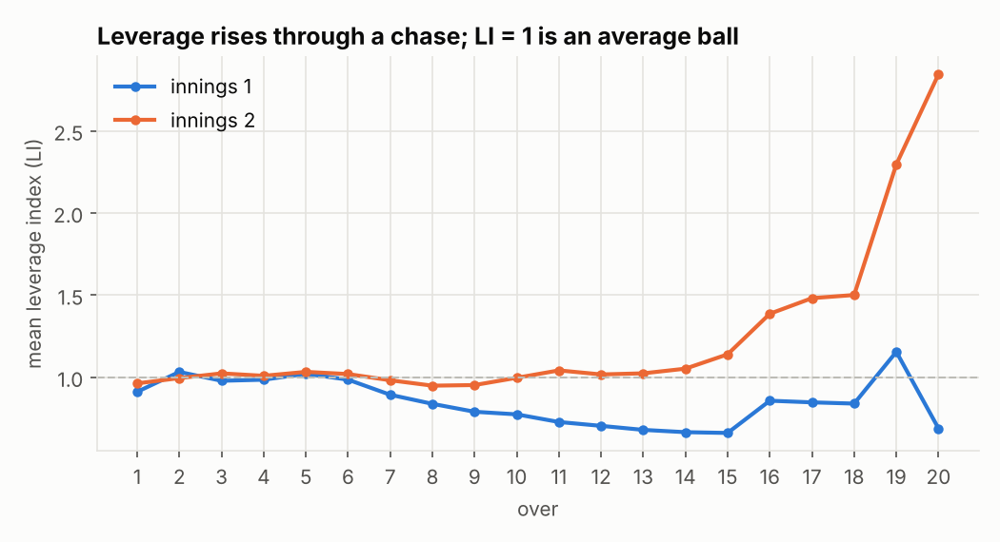

*Mean leverage by over. Leverage builds through a chase; innings 1 stays near average.*

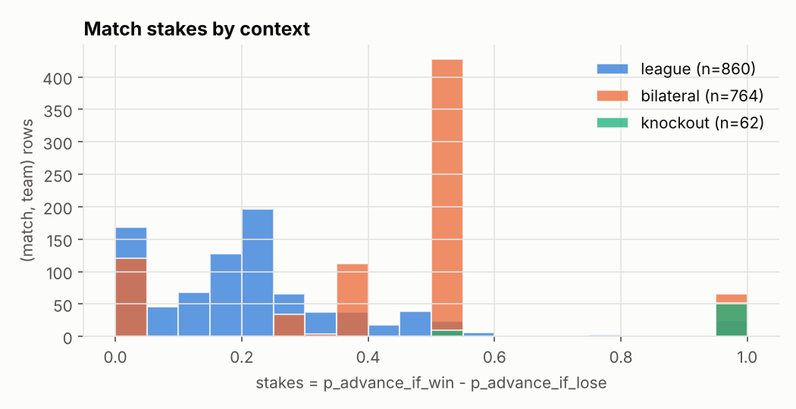

*Distribution of match stakes by context.*

**How it separates pressure from ordinary situations.** The top 1% of deliveries by LI (LI >= 5.42) are 94.4% second-innings, 87.9% in overs 16-20 and 90.6% in chases still in the balance (wp between 0.1 and 0.9). The full list is in `outputs/validation/data_7_6_top_leverage_balls.csv`.

## 3. Performance measurement, baselines and rating logic

**Performance is what the situation needs.** Each ball is scored by win probability added: `WPA_bat = wp_after - wp_before`, `WPA_bowl = -WPA_bat`. With 2 needed off the last ball, a six off a yorker and a scrambled two both move wp to 1, so both earn the same WPA. Performance is not binary, and it scales with how much the moment mattered.

**Attribution.** Batters get WPA on every ball faced except wides, which belong to the bowler. A non-striker run-out is charged to the dismissed batter. Bowlers get WPA on every ball they bowl, but a run-out is charged as if only the runs happened (the wp of the runs-only counterfactual state), because run-outs are not bowler wickets.

**Per-stint inputs.** A batting stint runs from arrival at the crease to dismissal, retirement or the end of the innings. A bowling stint is one over by one bowler. For stint s with n balls:

```
y_s  = sum(WPA / max(LI, 0.1)) / n        performance per ball, situation leverage divided out
h_s  = clip(pressure_s - theta, 0, h_max)  pressure dose
w_s  = n_s * 0.5 ^ (age_days / 540)       recency weight for player terms
```

**The model.**

```
y_s = mu_r + beta_i - q_o + h_s * (c_i + tau_a - tau_o) + eps_s,     Var(eps_s) = sigma^2 / n_s
```

| Term | Meaning | Becomes |
|---|---|---|
| mu_r | role average (bat, bowl) | |
| beta_i | the player's usual level at ordinary pressure | **baseline** |
| q_o | opponent's general strength at any pressure | nuisance |
| c_i | change in the player's performance per unit of pressure, versus their own baseline | **P** |
| tau_a, tau_o | clutch of own team and of the opponent | **T** |

(c_i + tau_a - tau_o) is the net response to pressure. "My team makes pressure easier" and "my team makes me better" are the same +tau_a; a bottling opponent (low tau_o) helps in the same way. tau is the lift shared by everyone in a shirt; c is what a player carries from team to team. Players who move between teams (IPL auctions, IPL plus country) are what separates the two.

**Fitting (hard EM).** The loss `sum w (y - yhat)^2 + lambda_b sum beta^2 + lambda_c sum c^2 + lambda_q sum q^2 + lambda_tau sum tau^2` is minimised by alternating closed-form updates of mu, beta, c, q and tau. The loop starts from random c and tau and stops when the largest parameter change is below 1e-09. The final fit converged in 79 iterations. Player steps use the recency weights; team steps use n/2 (every ball sits in one batter stint and one bowler stint) with no recency, because T is one number for all years.

**Scores.** `P = 100 * Phi(c / s_c)`, where s_c is the sd of c over eligible players in the role; `T = 100 * Phi(tau / s_tau)`. 50 means no change under pressure, bottle jobs tend to 0, clutch players to 100.

**Recency.** With a half-life of 540 days, a stint from three years ago counts about a quarter as much as one from today. Ten recent bottles therefore outweigh ten old clutch performances, and the reverse.

## 4. Fair comparisons

- **Opportunity weighting (sample size).** The c update has the closed form `c_i = [E_i / (E_i + lambda_c)] x (raw pressure slope)`, with `E_i = sum omega n h^2`. E grows with how often, how hard and how recently a player was under pressure. A bowler with hundreds of pressure overs keeps most of his slope. A player with two clutch stints is pulled almost to zero, so he sits near P = 50 without any extra rule.
- **Penalties by cross-validation**: 5-fold CV grouped by match, minimising weighted squared error on held-out stints, coordinate search over the grid [30, 100, 300, 1000, 3000, 10000, 30000]. Chosen: lambda_beta = 300, lambda_c = 1,000, lambda_q = 1,000, lambda_tau = 30,000. k, theta, h_max and the half-life were fixed in advance and only reported as sensitivities (section 7).
- **Eligibility gates.** Batters need >= 20 pressure stints and >= 150 balls in them. Bowlers need >= 40 pressure overs. Everyone needs >= 5 pressure stints in the last 24 months, so "right now" has support. Ranked players must also **deliver** under pressure (beta + c > 0: above the role average at h = 1), so a weak player who merely declines less cannot top a "best under pressure" list. And they must be selectable in the dropdown.

| role   |   exposure |   recent |   delivers |   selectable |   eligible |
|:-------|-----------:|---------:|-----------:|-------------:|-----------:|
| bat    |        132 |      205 |        340 |          890 |         92 |
| bowl   |        141 |      277 |        275 |          647 |         73 |

- **Different match contexts.** The opponent's general strength enters the baseline as q_o, so a mismatch in a minor T20I does not inflate anyone's baseline. Stakes put a dead rubber below a series decider, and an early-season IPL game below a must-win.
- **IPL and T20I together.** One model and one scale. Format differences are absorbed by the wp model (format and Impact Player era are state inputs) and by dividing out leverage. A player keeps a single P per role across all teams. Every IPL franchise and national side has one T for all years.
- **Per-role P.** Batting and bowling are scored separately (two lists). All-rounders get both. A single exposure-weighted P per player is in `outputs/player_scores.csv` (`P_combined`).

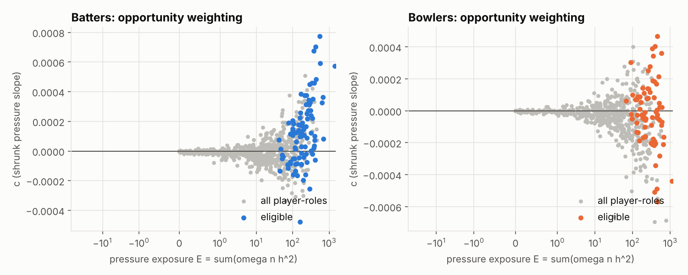

*Shrinkage by exposure: thin-sample players are pulled to c = 0 (P = 50).*

## 5. Evidence for the top 10

Columns: P with its 90% cluster-bootstrap interval (300 resamples of matches) and P(top 10); c (pressure slope) and beta (baseline), both per ball; E (effective pressure exposure); the raw performance per ball in pressure versus ordinary stints. Rank order is P, with ties broken by P(top 10).

### Batters

|   # | Player               |      P | 90% interval   |   P(top 10) |   c x1e4 |   beta x1e3 |    E |   pressure stints |   pressure balls |   y press x1e3 |   y ord x1e3 | Teams                                                                |
|----:|:---------------------|-------:|:---------------|------------:|---------:|------------:|-----:|------------------:|-----------------:|---------------:|-------------:|:---------------------------------------------------------------------|
|   1 | Shreyas Iyer         | 100.00 | 81.4 - 100.0   |        0.80 |     7.72 |        2.02 |  544 |                50 |              997 |           1.50 |         0.51 | India; Kolkata Knight Riders; Punjab Kings                           |
|   2 | Rovman Powell        |  99.90 | 87.9 - 100.0   |        0.83 |     7.02 |        0.73 |  419 |                63 |             1021 |           1.74 |        -1.95 | Delhi Capitals; Kolkata Knight Riders; Rajasthan Royals; West Indies |
|   3 | Mitchell Marsh       |  99.90 | 62.0 - 100.0   |        0.64 |     6.74 |        1.71 |  372 |                46 |             1062 |           1.62 |        -0.59 | Australia; Delhi Capitals; Lucknow Super Giants                      |
|   4 | Pathum Nissanka      |  99.70 | 73.5 - 100.0   |        0.65 |     5.91 |        0.67 |  557 |                60 |             1288 |          -0.25 |        -0.13 | Delhi Capitals; Sri Lanka                                            |
|   5 | Namboori Tilak Varma |  99.60 | 51.5 - 100.0   |        0.61 |     5.74 |        1.44 | 1442 |                62 |             1300 |           0.77 |         1.14 | India; India A; Mumbai Indians                                       |
|   6 | David Miller         |  98.60 | 55.8 - 99.8    |        0.43 |     4.83 |        1.10 |  434 |                50 |              765 |           1.66 |         0.34 | Delhi Capitals; Gujarat Titans; Lucknow Super Giants; South Africa   |
|   7 | Washington Sundar    |  98.20 | 58.0 - 99.9    |        0.44 |     4.60 |        0.83 |  333 |                26 |              387 |           0.99 |        -1.70 | Gujarat Titans; India; Sunrisers Hyderabad                           |
|   8 | Krunal Pandya        |  98.20 | 51.2 - 99.6    |        0.42 |     4.60 |        0.13 |  386 |                28 |              397 |          -0.27 |        -3.03 | Lucknow Super Giants; Royal Challengers Bengaluru                    |
|   9 | Ashutosh Sharma      |  98.00 | 66.2 - 99.1    |        0.36 |     4.50 |        0.63 |  285 |                20 |              245 |           1.89 |        -3.52 | Delhi Capitals; India A; Punjab Kings                                |
|  10 | Heinrich Klaasen     |  96.00 | 62.8 - 98.9    |        0.25 |     3.85 |        1.76 |  166 |                25 |              448 |           3.00 |         0.18 | South Africa; Sunrisers Hyderabad                                    |

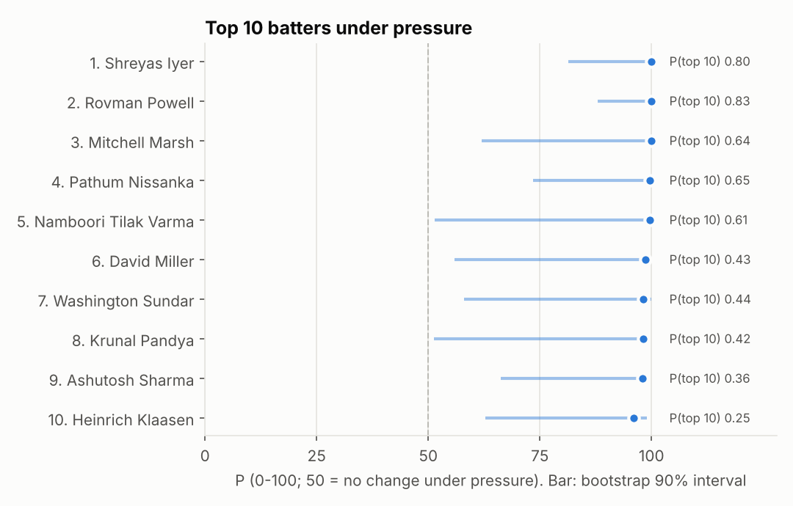

*Top 10 batters: P and bootstrap interval.*

**Batters: the three biggest pressure stints behind each ranking** (by n x h x (y - mu - beta + q_o)):

|   rank | Player               | date       | Competition                                  | team                        | opponent                    |   innings |   balls |     h |    WPA |   impact x1e3 |
|-------:|:---------------------|:-----------|:---------------------------------------------|:----------------------------|:----------------------------|----------:|--------:|------:|-------:|--------------:|
|      1 | Shreyas Iyer         | 2025-06-01 | IPL 2025                                     | Punjab Kings                | Mumbai Indians              |         2 |      41 | 3     |  0.954 |    888        |
|      1 | Shreyas Iyer         | 2026-04-25 | IPL 2026                                     | Punjab Kings                | Delhi Capitals              |         2 |      36 | 1.44  |  0.648 |    432        |
|      1 | Shreyas Iyer         | 2026-04-11 | IPL 2026                                     | Punjab Kings                | Sunrisers Hyderabad         |         2 |      33 | 0.796 |  0.373 |    208        |
|      2 | Rovman Powell        | 2023-03-25 | West Indies in South Africa T20I Series 2023 | West Indies                 | South Africa                |         2 |      18 | 3     |  1.13  |    782        |
|      2 | Rovman Powell        | 2024-12-16 | Bangladesh in West Indies T20I Series 2024   | West Indies                 | Bangladesh                  |         2 |      35 | 2.81  |  0.428 |    776        |
|      2 | Rovman Powell        | 2023-12-13 | England in West Indies T20I Series 2023      | West Indies                 | England                     |         2 |      15 | 2.98  |  0.615 |    569        |
|      3 | Mitchell Marsh       | 2025-10-04 | Australia in New Zealand T20I Series 2025    | Australia                   | New Zealand                 |         2 |      52 | 1.98  |  0.995 |      1.13e+03 |
|      3 | Mitchell Marsh       | 2024-02-21 | Australia in New Zealand T20I Series 2024    | Australia                   | New Zealand                 |         2 |      44 | 2.56  |  0.238 |    523        |
|      3 | Mitchell Marsh       | 2025-08-16 | South Africa in Australia T20I Series 2025   | Australia                   | South Africa                |         2 |      37 | 1.44  |  0.165 |    238        |
|      4 | Pathum Nissanka      | 2024-07-27 | India in Sri Lanka T20I Series 2024          | Sri Lanka                   | India                       |         2 |      48 | 2.9   |  0.192 |    709        |
|      4 | Pathum Nissanka      | 2024-11-10 | New Zealand in Sri Lanka T20I Series 2024    | Sri Lanka                   | New Zealand                 |         2 |      51 | 1.89  |  0.119 |    591        |
|      4 | Pathum Nissanka      | 2025-09-26 | Asia Cup 2025                                | Sri Lanka                   | India                       |         2 |      58 | 0.712 |  0.352 |    381        |
|      5 | Namboori Tilak Varma | 2025-01-25 | England in India T20I Series 2025            | India                       | England                     |         2 |      55 | 3     |  0.952 |    841        |
|      5 | Namboori Tilak Varma | 2026-10-24 | India in New Zealand T20I Series 2026        | India                       | New Zealand                 |         2 |      26 | 3     |  0.482 |    594        |
|      5 | Namboori Tilak Varma | 2025-09-28 | Asia Cup 2025                                | India                       | Pakistan                    |         2 |      53 | 3     |  0.736 |    560        |
|      6 | David Miller         | 2022-04-17 | IPL 2022                                     | Gujarat Titans              | Chennai Super Kings         |         2 |      51 | 1.59  |  1.09  |    865        |
|      6 | David Miller         | 2022-05-24 | IPL 2022                                     | Gujarat Titans              | Rajasthan Royals            |         2 |      38 | 3     |  0.906 |    572        |
|      6 | David Miller         | 2026-04-08 | IPL 2026                                     | Delhi Capitals              | Gujarat Titans              |         2 |      19 | 3     |  0.595 |    492        |
|      7 | Washington Sundar    | 2025-11-02 | India in Australia T20I Series 2025          | India                       | Australia                   |         2 |      23 | 1.5   |  0.602 |    443        |
|      7 | Washington Sundar    | 2026-05-03 | IPL 2026                                     | Gujarat Titans              | Punjab Kings                |         2 |      23 | 1.97  |  0.682 |    294        |
|      7 | Washington Sundar    | 2025-05-30 | IPL 2025                                     | Gujarat Titans              | Mumbai Indians              |         2 |      24 | 1.21  |  0.256 |    285        |
|      8 | Krunal Pandya        | 2026-05-10 | IPL 2026                                     | Royal Challengers Bengaluru | Mumbai Indians              |         2 |      46 | 3     |  0.146 |    580        |
|      8 | Krunal Pandya        | 2025-04-27 | IPL 2025                                     | Royal Challengers Bengaluru | Delhi Capitals              |         2 |      47 | 1.13  |  0.392 |    318        |
|      8 | Krunal Pandya        | 2022-04-19 | IPL 2022                                     | Lucknow Super Giants        | Royal Challengers Bengaluru |         2 |      28 | 0.871 |  0.073 |    183        |
|      9 | Ashutosh Sharma      | 2025-03-24 | IPL 2025                                     | Delhi Capitals              | Lucknow Super Giants        |         2 |      31 | 1.31  |  1.2   |    456        |
|      9 | Ashutosh Sharma      | 2025-11-21 | Asia Cup Rising Stars 2025                   | India A                     | Bangladesh A                |         2 |       6 | 3     | -0.221 |    198        |
|      9 | Ashutosh Sharma      | 2024-04-18 | IPL 2024                                     | Punjab Kings                | Mumbai Indians              |         2 |      28 | 0.885 |  0.05  |    179        |
|     10 | Heinrich Klaasen     | 2024-03-23 | IPL 2024                                     | Sunrisers Hyderabad         | Kolkata Knight Riders       |         2 |      29 | 1.95  |  0.305 |    401        |
|     10 | Heinrich Klaasen     | 2022-06-12 | South Africa in India T20I Series 2022       | South Africa                | India                       |         2 |      46 | 0.977 |  0.518 |    380        |
|     10 | Heinrich Klaasen     | 2026-04-29 | IPL 2026                                     | Sunrisers Hyderabad         | Mumbai Indians              |         2 |      30 | 0.948 |  0.401 |    231        |

### Bowlers

|   # | Player           |     P | 90% interval   |   P(top 10) |   c x1e4 |   beta x1e3 |   E |   pressure stints |   pressure balls |   y press x1e3 |   y ord x1e3 | Teams                                             |
|----:|:-----------------|------:|:---------------|------------:|---------:|------------:|----:|------------------:|-----------------:|---------------:|-------------:|:--------------------------------------------------|
|   1 | Sufiyan Muqeem   | 98.90 | 60.5 - 99.9    |        0.72 |     4.65 |        1.02 | 458 |                42 |              257 |           3.30 |         2.98 | Pakistan; Pakistan A                              |
|   2 | Mohammad Nawaz   | 97.60 | 44.5 - 99.8    |        0.71 |     4.02 |        2.01 | 392 |                99 |              600 |           1.57 |         4.03 | Pakistan                                          |
|   3 | Nathan Ellis     | 97.30 | 60.8 - 99.7    |        0.65 |     3.90 |        0.45 | 334 |                92 |              575 |           1.12 |         0.34 | Australia; Chennai Super Kings; Punjab Kings      |
|   4 | Rashid Khan      | 96.20 | 38.4 - 99.7    |        0.64 |     3.60 |        1.05 | 575 |               208 |             1263 |           1.88 |         1.63 | Afghanistan; Gujarat Titans                       |
|   5 | Richard Ngarava  | 95.50 | 64.5 - 97.8    |        0.66 |     3.45 |       -0.26 | 349 |               102 |              644 |           0.58 |        -2.70 | Zimbabwe                                          |
|   6 | Keshav Maharaj   | 93.30 | 46.8 - 99.6    |        0.53 |     3.04 |       -0.22 |  88 |                47 |              289 |          -0.40 |         0.43 | Rajasthan Royals; South Africa                    |
|   7 | Krunal Pandya    | 91.40 | 50.3 - 98.0    |        0.50 |     2.77 |        1.20 | 289 |               103 |              628 |           2.65 |         1.24 | Lucknow Super Giants; Royal Challengers Bengaluru |
|   8 | Sunil Narine     | 89.30 | 32.7 - 98.9    |        0.49 |     2.52 |        1.35 | 261 |                95 |              580 |           1.24 |         2.36 | Kolkata Knight Riders                             |
|   9 | Jofra Archer     | 85.60 | 7.1 - 100.0    |        0.44 |     2.15 |        1.27 | 498 |               120 |              755 |           0.71 |         1.31 | England; Mumbai Indians; Rajasthan Royals         |
|  10 | Mujeeb Ur Rahman | 82.30 | 54.6 - 90.0    |        0.20 |     1.88 |        0.76 | 337 |                84 |              520 |           2.94 |         0.92 | Afghanistan; Mumbai Indians                       |

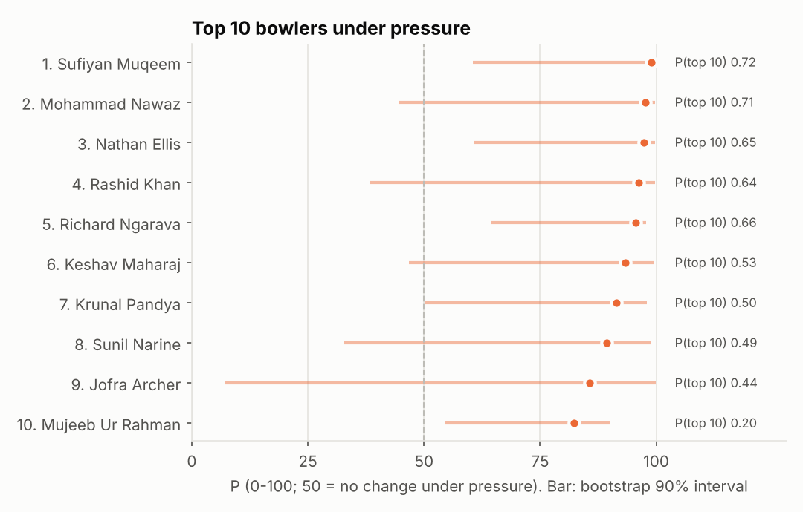

*Top 10 bowlers: P and bootstrap interval.*

**Bowlers: the three biggest pressure stints behind each ranking** (by n x h x (y - mu - beta + q_o)):

|   rank | Player           | date       | Competition                                  | team                  | opponent             |   innings |   over |   balls |     h |   WPA |   impact x1e3 |
|-------:|:-----------------|:-----------|:---------------------------------------------|:----------------------|:---------------------|----------:|-------:|--------:|------:|------:|--------------:|
|      1 | Sufiyan Muqeem   | 2025-11-23 | Asia Cup Rising Stars 2025                   | Pakistan A            | Bangladesh A         |         2 |     11 |       6 | 2.96  | 0.42  |         396   |
|      1 | Sufiyan Muqeem   | 2025-11-23 | Asia Cup Rising Stars 2025                   | Pakistan A            | Bangladesh A         |         2 |      7 |       6 | 3     | 0.207 |         279   |
|      1 | Sufiyan Muqeem   | 2025-11-21 | Asia Cup Rising Stars 2025                   | Pakistan A            | Sri Lanka A          |         2 |     10 |       6 | 3     | 0.288 |         252   |
|      2 | Mohammad Nawaz   | 2025-09-07 | United Arab Emirates T20I Tri-Series 2025    | Pakistan              | Afghanistan          |         2 |      6 |       6 | 2.15  | 0.367 |         451   |
|      2 | Mohammad Nawaz   | 2025-08-03 | Pakistan in West Indies T20I Series 2025     | Pakistan              | West Indies          |         2 |      9 |       7 | 1.58  | 0.092 |         411   |
|      2 | Mohammad Nawaz   | 2025-07-31 | Pakistan in West Indies T20I Series 2025     | Pakistan              | West Indies          |         2 |     12 |       6 | 1.59  | 0.344 |         339   |
|      3 | Nathan Ellis     | 2023-05-13 | IPL 2023                                     | Punjab Kings          | Delhi Capitals       |         2 |     16 |       6 | 3     | 0.275 |         275   |
|      3 | Nathan Ellis     | 2026-06-19 | Australia in Bangladesh T20I Series 2026     | Australia             | Bangladesh           |         2 |     17 |       6 | 3     | 0.452 |         274   |
|      3 | Nathan Ellis     | 2023-05-03 | IPL 2023                                     | Punjab Kings          | Mumbai Indians       |         2 |      6 |       6 | 1.3   | 0.177 |         181   |
|      4 | Rashid Khan      | 2026-04-08 | IPL 2026                                     | Gujarat Titans        | Delhi Capitals       |         2 |     14 |       6 | 3     | 0.35  |         310   |
|      4 | Rashid Khan      | 2024-12-09 | Afghanistan in Zimbabwe T20I Series 2024     | Afghanistan           | Zimbabwe             |         2 |     17 |       7 | 1.77  | 0.18  |         254   |
|      4 | Rashid Khan      | 2025-10-03 | Afghanistan v Bangladesh T20I Series 2025    | Afghanistan           | Bangladesh           |         2 |     17 |       6 | 3     | 0.348 |         252   |
|      5 | Richard Ngarava  | 2026-07-15 | Bangladesh in Zimbabwe T20I Series 2026      | Zimbabwe              | Bangladesh           |         2 |      4 |       6 | 1.56  | 0.213 |         207   |
|      5 | Richard Ngarava  | 2024-12-12 | Afghanistan in Zimbabwe T20I Series 2024     | Zimbabwe              | Afghanistan          |         2 |      3 |       7 | 1.58  | 0.124 |         204   |
|      5 | Richard Ngarava  | 2025-11-19 | Pakistan T20I Tri-Series 2025                | Zimbabwe              | Sri Lanka            |         2 |      1 |       7 | 2.09  | 0.194 |         183   |
|      6 | Keshav Maharaj   | 2026-03-22 | South Africa in New Zealand T20I Series 2026 | South Africa          | New Zealand          |         2 |     14 |       6 | 3     | 0.583 |         463   |
|      6 | Keshav Maharaj   | 2022-07-28 | South Africa in England T20I Series 2022     | South Africa          | England              |         2 |      6 |       6 | 0.528 | 0.039 |          70.9 |
|      6 | Keshav Maharaj   | 2026-03-25 | South Africa in New Zealand T20I Series 2026 | South Africa          | New Zealand          |         2 |      9 |       6 | 1.93  | 0.048 |          63.7 |
|      7 | Krunal Pandya    | 2022-04-29 | IPL 2022                                     | Lucknow Super Giants  | Punjab Kings         |         2 |     14 |       6 | 2.62  | 0.361 |         332   |
|      7 | Krunal Pandya    | 2022-03-28 | IPL 2022                                     | Lucknow Super Giants  | Gujarat Titans       |         2 |     11 |       6 | 2.53  | 0.228 |         221   |
|      7 | Krunal Pandya    | 2022-04-04 | IPL 2022                                     | Lucknow Super Giants  | Sunrisers Hyderabad  |         2 |     11 |       6 | 2.56  | 0.281 |         215   |
|      8 | Sunil Narine     | 2024-04-26 | IPL 2024                                     | Kolkata Knight Riders | Punjab Kings         |         2 |     13 |       6 | 1.84  | 0.359 |         305   |
|      8 | Sunil Narine     | 2025-04-29 | IPL 2025                                     | Kolkata Knight Riders | Delhi Capitals       |         2 |     14 |       6 | 1.41  | 0.347 |         296   |
|      8 | Sunil Narine     | 2026-04-09 | IPL 2026                                     | Kolkata Knight Riders | Lucknow Super Giants |         2 |     16 |       6 | 2.96  | 0.298 |         217   |
|      9 | Jofra Archer     | 2026-04-25 | IPL 2026                                     | Rajasthan Royals      | Sunrisers Hyderabad  |         2 |      1 |       7 | 2.25  | 0.158 |         591   |
|      9 | Jofra Archer     | 2026-05-24 | IPL 2026                                     | Rajasthan Royals      | Mumbai Indians       |         2 |     16 |       6 | 3     | 0.194 |         210   |
|      9 | Jofra Archer     | 2023-03-09 | England in Bangladesh T20I Series 2023       | England               | Bangladesh           |         2 |      5 |       6 | 1.37  | 0.134 |         129   |
|     10 | Mujeeb Ur Rahman | 2025-09-18 | Asia Cup 2025                                | Afghanistan           | Sri Lanka            |         2 |     12 |       6 | 3     | 0.003 |         307   |
|     10 | Mujeeb Ur Rahman | 2023-07-14 | Afghanistan in Bangladesh T20I Series 2023   | Afghanistan           | Bangladesh           |         2 |      6 |       6 | 1.23  | 0.087 |         169   |
|     10 | Mujeeb Ur Rahman | 2022-09-03 | Mens Twenty20 Asia Cup 2022                  | Afghanistan           | Sri Lanka            |         2 |      9 |       6 | 1.04  | 0.064 |         112   |

**Identification flag.** These ranked players' teams have no movers linking them to the main player-team network, so their split between P and T rests on the penalties alone (plan section 6): Sufiyan Muqeem (bowl #1; Pakistan; Pakistan A); Mohammad Nawaz (bowl #2; Pakistan).

## 6. Team clutch T and the CSK claim

| Team                        |    T |   tau x1e5 |   q x1e4 |   movers | no movers   |
|:----------------------------|-----:|-----------:|---------:|---------:|:------------|
| South Africa                | 99.9 |       13.0 |     -5.8 |       27 | False       |
| Australia                   | 94.9 |        6.7 |      2.7 |       28 | False       |
| Gujarat Titans              | 90.2 |        5.3 |      2.3 |       39 | False       |
| Afghanistan A               | 81.1 |        3.6 |     -2.1 |       14 | False       |
| Bangladesh                  | 77.7 |        3.1 |     -4.9 |       10 | False       |
| Ireland                     | 76.7 |        3.0 |     -8.9 |        1 | False       |
| Lucknow Super Giants        | 76.5 |        3.0 |     -1.5 |       45 | False       |
| West Indies                 | 76.0 |        2.9 |     -5.8 |       17 | False       |
| Sunrisers Hyderabad         | 75.2 |        2.8 |     -3.2 |       47 | False       |
| Hong Kong                   | 74.8 |        2.7 |    -11.0 |        0 | True        |
| Nepal                       | 68.3 |        1.9 |     -0.1 |        0 | True        |
| Pakistan                    | 67.5 |        1.9 |      0.4 |       13 | False       |
| Pakistan A                  | 63.4 |        1.4 |      6.1 |       13 | False       |
| Zimbabwe                    | 62.7 |        1.3 |    -12.7 |        2 | False       |
| Kuwait                      | 56.0 |        0.6 |     -1.1 |        0 | True        |
| United States Of America    | 54.0 |        0.4 |     -5.2 |        0 | True        |
| Canada                      | 53.3 |        0.3 |     -5.2 |        0 | True        |
| Mumbai Indians              | 51.1 |        0.1 |     -2.1 |       54 | False       |
| Chennai Super Kings         | 50.9 |        0.1 |     -3.0 |       44 | False       |
| England                     | 50.4 |        0.0 |      5.0 |       22 | False       |
| New Zealand                 | 50.0 |        0.0 |      1.4 |       18 | False       |
| Japan                       | 48.7 |       -0.1 |      1.8 |        0 | True        |
| India A                     | 48.5 |       -0.2 |      1.7 |       23 | False       |
| United Arab Emirates        | 39.9 |       -1.0 |    -10.9 |        0 | True        |
| Delhi Capitals              | 35.2 |       -1.6 |     -2.2 |       45 | False       |
| Bangladesh A                | 34.5 |       -1.6 |      1.5 |        8 | False       |
| Sri Lanka A                 | 34.5 |       -1.6 |      2.7 |       11 | False       |
| Scotland                    | 34.5 |       -1.6 |     -8.6 |        0 | True        |
| Royal Challengers Bengaluru | 34.0 |       -1.7 |      2.7 |       41 | False       |
| Punjab Kings                | 30.8 |       -2.0 |     -0.7 |       44 | False       |
| Rajasthan Royals            | 28.2 |       -2.4 |      0.5 |       42 | False       |
| Singapore                   | 26.9 |       -2.5 |     -6.0 |        0 | True        |
| Oman                        | 26.5 |       -2.6 |     -7.3 |        0 | True        |
| Kolkata Knight Riders       | 19.0 |       -3.6 |      1.4 |       43 | False       |
| Netherlands                 | 14.0 |       -4.4 |     -2.6 |        0 | True        |
| Sri Lanka                   |  2.1 |       -8.3 |     -3.2 |       22 | False       |
| India                       |  1.1 |       -9.4 |      7.8 |       57 | False       |
| Afghanistan                 |  1.0 |       -9.5 |     -3.1 |       23 | False       |

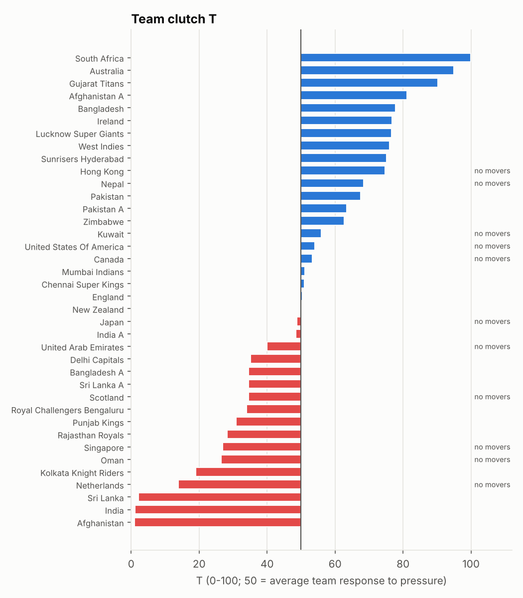

*T by team (50 = average).*

T is identified by players who appear for more than one team. 63.5% of pressure exposure comes from player-roles with 2+ teams. The player-team graph has 13 connected components; the largest links 25 teams. Teams with no movers: Hong Kong, Nepal, Kuwait, United States Of America, Canada, Japan, United Arab Emirates, Scotland, Singapore, Oman, Netherlands.

**The CSK claim** (distinct man-of-the-match winners per win, IPL, from matches.csv):

| team_canon                  |   wins_with_mom |   distinct_mom |   distinct_per_win |   top_player_share |     T |
|:----------------------------|----------------:|---------------:|-------------------:|-------------------:|------:|
| Mumbai Indians              |              30 |             19 |               0.63 |               0.13 | 51.10 |
| Punjab Kings                |              34 |             20 |               0.59 |               0.15 | 30.85 |
| Delhi Capitals              |              33 |             19 |               0.58 |               0.21 | 35.17 |
| Sunrisers Hyderabad         |              34 |             19 |               0.56 |               0.21 | 75.20 |
| Lucknow Super Giants        |              34 |             18 |               0.53 |               0.15 | 76.55 |
| Royal Challengers Bengaluru |              43 |             21 |               0.49 |               0.21 | 34.01 |
| Rajasthan Royals            |              37 |             18 |               0.49 |               0.16 | 28.19 |
| Chennai Super Kings         |              31 |             15 |               0.48 |               0.16 | 50.94 |
| Kolkata Knight Riders       |              34 |             15 |               0.44 |               0.18 | 19.02 |
| Gujarat Titans              |              45 |             18 |               0.40 |               0.24 | 90.18 |

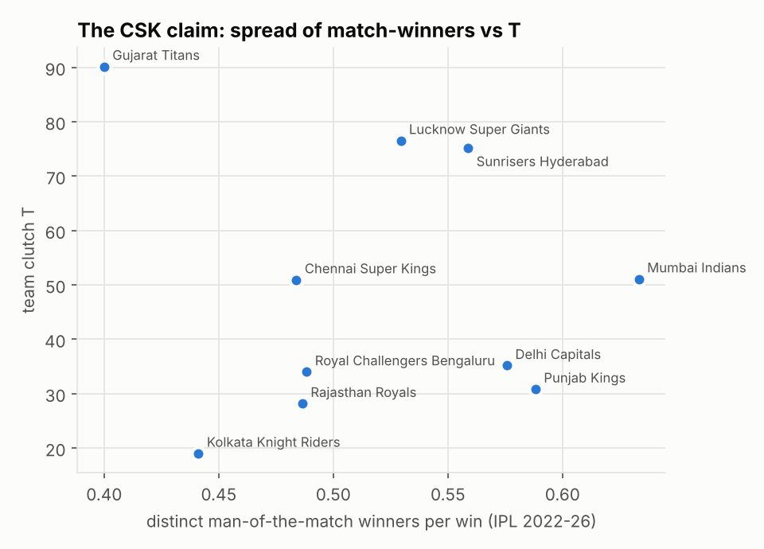

*Distinct match-winners per win against T (IPL).*

## 7. Reliability

### 7a. The situation layer (Jev spec section 7)

- **Calibration** (wp deciles vs actual winners): innings 1 Brier 0.219, worst decile gap 0.0668; innings 2 Brier 0.128, worst gap 0.0253.
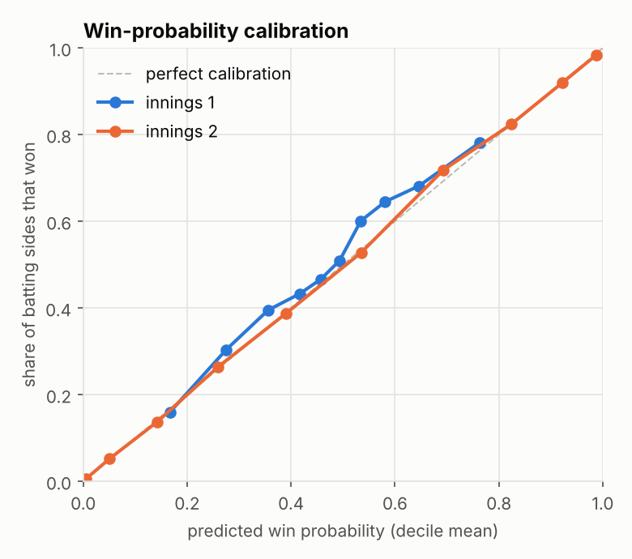

*Win-probability calibration by innings.*

- **Martingale:** mean WPA over all balls is -7.45e-05. By innings and phase:

| innings   | phase     |   mean_wpa |      se |      n |     z |
|:----------|:----------|-----------:|--------:|-------:|------:|
| 1         | death     |   -6.4e-05 | 0.00012 |  25709 | -0.51 |
| 1         | middle    |    0.00012 | 8.8e-05 |  46705 |  1.3  |
| 1         | powerplay |    0.00015 | 0.00014 |  31592 |  1.1  |
| 2         | death     |    0.0002  | 0.00048 |  18495 |  0.41 |
| 2         | middle    |   -0.00014 | 0.00016 |  45108 | -0.89 |
| 2         | powerplay |   -0.00065 | 0.00018 |  31599 | -3.7  |
| all       | all       |   -7.4e-05 | 7.2e-05 | 199208 | -1    |

- **Sanity:** 322 violations of "more runs never lowers wp, a wicket never raises it" over about 1.8M hypothetical comparisons. They sit where a hypothetical crosses the innings break.

|   innings | check                 |   violations |   share |      n |
|----------:|:----------------------|-------------:|--------:|-------:|
|         1 | wp(dot) >= wp(wicket) |           81 |  0.0008 | 104006 |
|         1 | wp(wide) >= wp(dot)   |          214 |  0.0021 | 104006 |
|         2 | wp(dot) >= wp(wicket) |           11 |  0.0001 |  95202 |
|         2 | wp(wide) >= wp(dot)   |           16 |  0.0002 |  95202 |

- **Consistency of hypotheticals:** on 192,844 balls whose real outcome is one of the nine classes, the real next state's wp equals the hypothetical's on 100.0% (mean |diff| 7.17e-08).
- **Stakes vs actual advancement:** the realised p_advance has Brier 0.142 against actual qualification, compared with 0.25 for a coin flip (860 league-stage (match, team) rows).

|   p_mean |   advanced |   n | bin           |
|---------:|-----------:|----:|:--------------|
|    0.020 |      0.046 | 219 | (-0.001, 0.1] |
|    0.212 |      0.231 | 160 | (0.1, 0.3]    |
|    0.411 |      0.374 | 139 | (0.3, 0.5]    |
|    0.592 |      0.589 | 124 | (0.5, 0.7]    |
|    0.785 |      0.781 | 105 | (0.7, 0.9]    |
|    0.987 |      0.956 | 113 | (0.9, 1.0]    |

- **High-leverage balls:** see section 2. **p_next vs empirical frequencies:** max cell gap 0.238; the largest gaps are in cells with under 50 balls.
- **Reproducibility:** empirical provider: seeded and deterministic; re-running stage 2 reproduces the same numbers (compare the hash above)

### 7b. The model (plan section 11)

1. **Synthetic recovery.** Known c and tau were planted on the real schedule, with noise at the observed sigma, and the model was refit. Effect sizes are multiples of the spread the CV-chosen penalties allow (sd_c = 9.59e-04, sd_tau = 1.24e-04):

|   planted size (x prior sd) |   spearman_c_eligible |   corr_c_eligible |   corr_tau |
|----------------------------:|----------------------:|------------------:|-----------:|
|                       0.500 |                 0.259 |             0.292 |      0.278 |
|                       1.000 |                 0.537 |             0.530 |      0.455 |
|                       2.000 |                 0.749 |             0.757 |      0.524 |
|                       4.000 |                 0.893 |             0.839 |      0.589 |

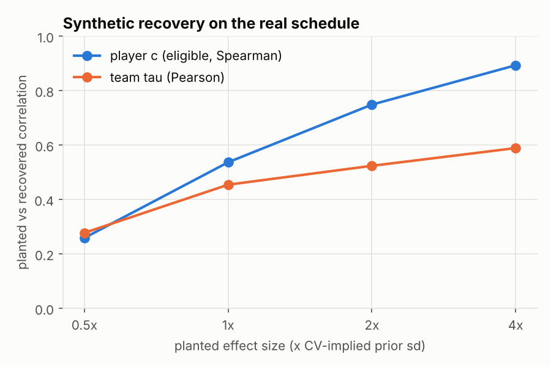

*Planted vs recovered effects.*

2. **Mover graph:** 13 components; 63.5% of pressure exposure comes from movers (per-team counts in `outputs/validation/model_11_2_movers_by_team.csv`).
3. **Start stability:** 20 random starts agree to 6.16e-10 (parameter scale 3.78e-03); all converged: True.
4. **One-shot check:** with split_weights off, the loop matches a single sparse ridge solve of the same loss to 4.20e-12.
5. **Out-of-time:** fitted on matches up to 2024-12-31, the Spearman correlation of c with each player's 2025-26 pressure slope is -0.011 (n = 285, p = 0.86) for batters and 0.038 (n = 240, p = 0.55) for bowlers. For players eligible on the training data it is -0.063 (n = 51, p = 0.66) and -0.19 (n = 50, p = 0.18).
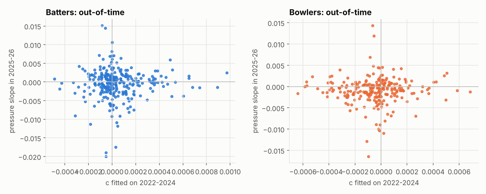

*Out-of-time: fitted c vs the next period's pressure slope.*

6. **Cluster bootstrap:** median 90%-interval width in the top 10 is 37.05 P points for batters and 50.30 for bowlers. The mean P(top 10) of the listed players is 0.54 and 0.55.
7. **Shuffle tests:** the real spread of c divided by its spread under the null is 0.936 (h permuted within player and stint-length band) and 1.02 (baseline residual signs flipped). Values near 1 mean the spread of c is largely what noise alone would produce.
8. **Ablations and sensitivities** (refit with the main penalties; overlap with the main top 10):

| ablation              | role   |   top10_overlap | same_rank1   |   spearman_c_common_eligible |   n_eligible |
|:----------------------|:-------|----------------:|:-------------|-----------------------------:|-------------:|
| T off                 | bat    |            1.00 | True         |                         1.00 |           92 |
| T off                 | bowl   |            0.90 | True         |                         1.00 |           74 |
| q off                 | bat    |            0.90 | True         |                         1.00 |           91 |
| q off                 | bowl   |            0.90 | True         |                         0.99 |           73 |
| k=0                   | bat    |            0.70 | True         |                         0.91 |           50 |
| k=0                   | bowl   |            0.70 | False        |                         0.91 |           58 |
| k=0.5                 | bat    |            0.80 | True         |                         0.97 |           83 |
| k=0.5                 | bowl   |            0.70 | False        |                         0.97 |           68 |
| k=2                   | bat    |            1.00 | False        |                         0.95 |           96 |
| k=2                   | bowl   |            0.70 | False        |                         0.92 |           80 |
| theta=1.5             | bat    |            0.60 | False        |                         0.95 |           30 |
| theta=1.5             | bowl   |            0.70 | False        |                         0.94 |           51 |
| theta=p75             | bat    |            0.40 | False        |                         0.92 |           21 |
| theta=p75             | bowl   |            0.60 | False        |                         0.94 |           41 |
| h_max=2.0             | bat    |            1.00 | True         |                         0.99 |           92 |
| h_max=2.0             | bowl   |            1.00 | False        |                         0.97 |           75 |
| h_max=None            | bat    |            0.60 | True         |                         0.98 |           93 |
| h_max=None            | bowl   |            0.90 | False        |                         0.83 |           73 |
| H=365                 | bat    |            0.90 | True         |                         0.98 |           85 |
| H=365                 | bowl   |            0.90 | True         |                         0.96 |           68 |
| H=730                 | bat    |            0.90 | False        |                         0.99 |           93 |
| H=730                 | bowl   |            0.90 | True         |                         0.98 |           76 |
| H=None                | bat    |            0.40 | False        |                         0.85 |          100 |
| H=None                | bowl   |            0.60 | False        |                         0.79 |           73 |
| entry_li              | bat    |            0.40 | False        |                         0.41 |           77 |
| entry_li              | bowl   |            0.80 | False        |                         0.66 |           73 |
| emerging cups dropped | bat    |            0.90 | True         |                         1.00 |           89 |
| emerging cups dropped | bowl   |            0.90 | False        |                         1.00 |           73 |

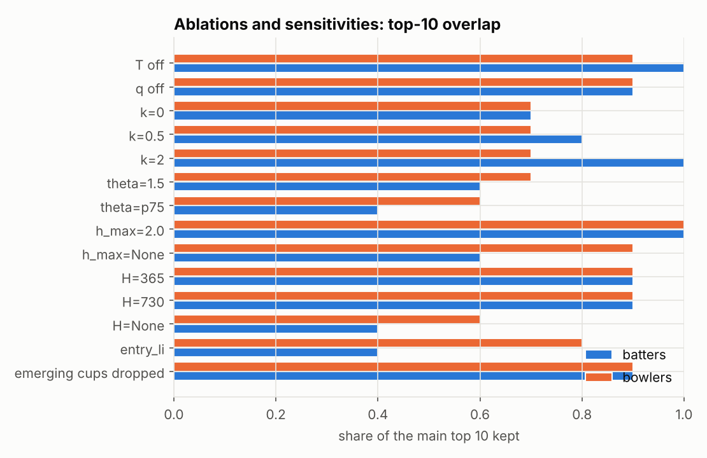

*Top-10 overlap under each ablation.*

9. **The CSK claim:** section 6.

## 8. Limitations and where the model is less certain

1. **The clutch signal is small.** The out-of-time, shuffle and synthetic results all say the same thing: most of the spread in P is noise. The top-10 ordering is the best estimate the data support, not a sharp separation. The bootstrap intervals and P(top 10) show how firm each place is.
2. **T is weak in this window.** CV shrinks tau hard. Teams without movers have T split from their players' P by the penalties alone (section 6).
3. **mean_li is partly caused by the player.** A batter who kills a chase lowers his own stint's pressure. The entry_li ablation shows how much this moves the list.
4. **Stint grain.** One pressure value for a 40-ball innings blurs the signal. Cutting batter stints at over boundaries is a drop-in upgrade; the equations are unchanged.
5. **Win-probability quality.** Everything rests on wp. The provider never sees team identity, so wp describes an average team by design. That way T is learned rather than assumed.
6. **One T for all years** hides real changes inside a franchise. Accepted by design.
7. **Opponent individuals are not modelled.** A six off a great bowler counts the same as a two off a poor one; opponents enter only through q and tau.
8. **Stakes** for bilaterals and minor tournaments are coarser than for the IPL. Byes and leg-byes count in bowler WPA (`attribution.bowler_charged_for_byes` switches this to a no-bye counterfactual).

## 9. Reproducing this report

```bash
pip install -r requirements.txt
cp /path/to/data-pack/*.csv data/raw/
export TYPESAFE_API_KEY=...        # optional: use Jev for calls A/B/C (cached in data/jev_cache/)
make all                           # or: python -m superr run all
```

Providers used in this run: {'wp': 'empirical', 'p_next': 'empirical', 'stakes': 'empirical'}. Seeds are fixed. Every switch named above is in `config/config.yaml`.
